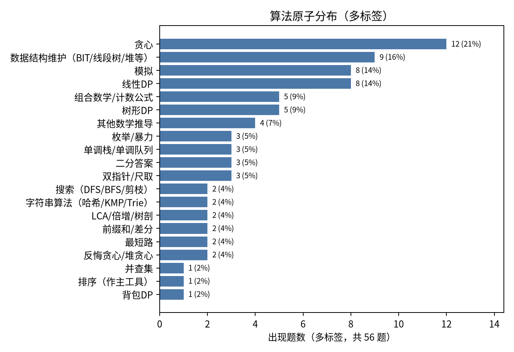
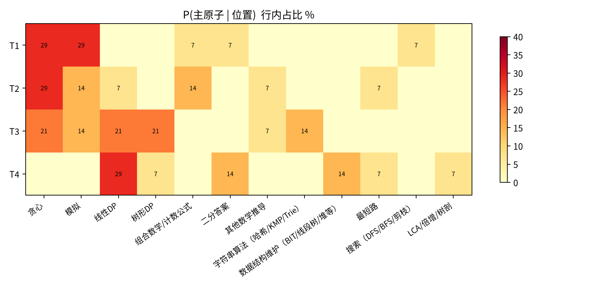
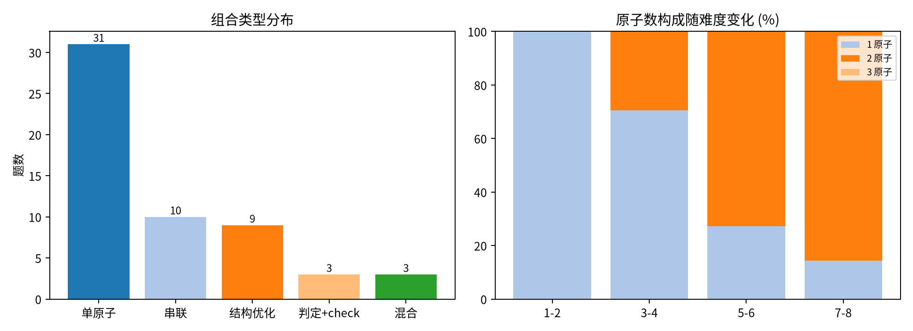
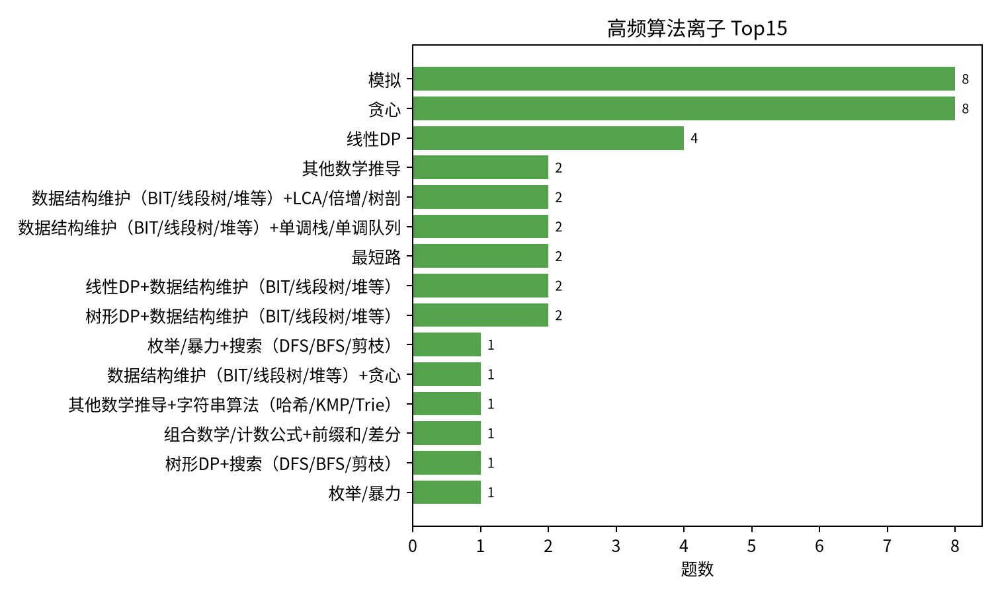

# 近五年 CSP-J/S 与 NOIP 真题趋势报告（2022–2026）

> 统计口径：2022–2026 年 CSP-J/S 第二轮（复赛）与 NOIP，覆盖洛谷新难度 **1–8 全部难度档**，共 **56 道题**。
> 数据来源：CCF 官方题面/公告、洛谷公开题面与难度标注。整理时间：2026-11-24。

## 写在前面

这是一份“看趋势”的报告，不是题解，也不押题。

它只回答三个问题：

1. 近五年的复赛题，正解到底集中在哪些算法？
2. 一道题是不是往往不止一个算法？高难题的“组合”长什么样？
3. 题号（T1–T4）和难度能不能帮我们在考场上快速缩小范围？

如果你是刚学 OI 的同学，可以把这当作“学习路线参考”；如果你是家长或老师，可以把它当作“这张卷子在考什么”的通俗说明。

## 一句话结论

**低难度题在考“把题读对、写对”，中档题在考“基础算法 + 一点点结构”，高难题在考“基础算法 + 数据结构优化”的组合。** 近五年多算法题明显变多，但组合方式非常分散，没有可以死记的“万能套路”。

## 一、样本长什么样

| 项目 | 数量 |
|---|---|
| 2022–2026 年数 | 5 年 |
| 题目总数 | 56 道 |
| 难度 1–2（入门 / 普及-） | 14 道 |
| 难度 3–4（普及 / 普及+） | 17 道 |
| 难度 5–6（提高 / 提高+） | 11 道 |
| 难度 7–8（省选 / NOI-） | 14 道 |

说明：2026 年目前只有 CSP-J/S 两场（共 8 道），NOIP 2026 在 11 月 28 日举行，尚未计入。洛谷难度是 2026 年 7 月改版后的 1–8 档，属于“主观评定 + 会调整”的参考值，不是官方难度。

## 二、真题都在考什么

把每道题的正解拆成“算法原子”（一个不可省略的算法阶段），按出现次数统计：

| 算法原子 | 出现题数（多标签 / 56 题） |
|---|---|
| 贪心 | 12 |
| 数据结构维护（树状数组 / 线段树 / 堆等） | 9 |
| 模拟 | 8 |
| 线性 DP | 8 |
| 组合数学 / 计数公式 | 5 |
| 树形 DP | 5 |
| 其他数学推导 | 4 |
| 枚举、单调栈/队列、二分答案、双指针 | 各 3 |
| 搜索、字符串、LCA、前缀和、最短路、反悔贪心 | 各 2 |

几个直观结论：

- **贪心是近五年出现最多的“正解主干”**，比模拟还多；很多看起来像模拟的题，最后一步是“排序后贪心”。
- **数据结构维护（树状数组/线段树/堆/单调队列）出现率仅次于贪心**，主要挂在 DP 或贪心上，而不是单独出道数据结构题。
- 纯 DP（线性 / 树形 / 计数 / 背包）合计仍然是最大的“算法家族”，只是被拆成了多个原子。
- 模拟集中在难度 1–2：低难度题先把“读题 + 实现”练稳，比背算法更重要。

## 三、难度和题号：位置本身也是信息

56 道题里，T1–T4 的平均难度逐级上升：

| 位置 | 平均难度 | 常见主算法 | 多算法题占比 |
|---|---|---|---|
| T1 | 2.50 | 模拟、贪心 | 21% |
| T2 | 3.86 | 贪心、数学、简单 DP | 29% |
| T3 | 5.36 | 树形 DP、线性 DP、贪心 | 57% |
| T4 | 5.93 | 线性 DP、二分答案、数据结构 | 71% |

两条例题式的经验：

1. **T1 几乎不会出现数据结构优化或复杂 DP**，先把模拟/贪心/简单数学想清楚即可。
2. **T4 有约 43% 的题需要“数据结构维护”**，而且大部分是“DP 或贪心 + 线段树/树状数组/堆/单调队列”的组合。

所以考场上可以先看题号，估一个“这题大概会考什么”的范围；但位置只是先验，**不能当硬规则**（T4 也可能出思维难度不高的题）。

## 四、一道题不止一个算法：多算法是常态

把“一个算法”叫**原子**，把“多个算法紧密结合”叫**离子**，只是为了好记。

按“正解主干里至少有两个不可省略的算法阶段”来统计：

- **44.6%（25/56）的题是多算法题**；
- 多算法比例随难度单调上升：难度 1–2 为 **0%**，难度 3–4 为 29%，难度 5–6 为 **73%**，难度 7–8 为 **86%**。

多算法题内部，组合方式大致分四类：

| 组合类型 | 占比 | 典型样子 |
|---|---|---|
| 串联（pipeline） | 18% | 先缩点/预处理，再做 DP 或枚举 |
| 结构优化（optimize） | 16% | DP / 贪心 + 树状数组 / 线段树 / 堆 / 单调队列 |
| 判定 + check | 5% | 二分答案 + 差分 / 贪心检查 |
| 混合（hybrid） | 5% | 数学推导 + 构造 + 模拟收尾 |

**最高频、也最值得练的组合是“基础算法 + 数据结构优化”**：高难题里它反复出现，而不是“再学一个更冷门的算法”。

## 五、常见“离子”长什么样

把多算法题按组合统计，一共出现 21 种不同的组合，但**只有 4 种出现过 2 次以上**：

| 组合 | 出现次数 |
|---|---|
| 数据结构维护 + LCA/倍增 | 2 |
| 数据结构维护 + 单调栈/队列 | 2 |
| 线性 DP + 数据结构维护 | 2 |
| 树形 DP + 数据结构维护 | 2 |

其余 17 种都只出现 1 次。这个结果说明：

- **不要背“组合表”**，它不像“算法族”那样有稳定高频项；
- 能稳定说的只有一句：**高难题优先考虑“在基础算法上挂数据结构”**；
- 单算法题仍占 55%，不要把所有题都过度组合化。

## 六、复杂度：2026 年的机器和预算

CSP-J/S 2026 第二轮官方题面写明了评测环境（这是公开信息）：

- 评测机：**Intel Core Ultra 9 285K @ 3.70GHz**（关闭睿频与能效核），内存 96 GB；
- 编译选项：**-O2 -std=c++14 -static**；
- 评测系统：最新 NOI Linux（g++ 9.3.0）。

这意味着 1 秒大约可以做：

| 规模 | 建议的复杂度上限 |
|---|---|
| n ≤ 20 | 状压 / 暴搜（2^n 级） |
| n ≤ 100 | O(n³) |
| n ≤ 1e3–1e4 | O(n²)（1e4 要小心常数） |
| n ≤ 1e5 | O(n log n) 或 O(n) |
| n ≤ 1e6 | O(n) 或常数很小的 O(n log n) |

经验上，**1 秒按 2×10⁸ 次“基本操作”估比较稳**（涉及大量随机访存、STL、大常数时应更保守）。按这个预算回看 56 道题，它们的正解都留有余量——也就是说，这些题主要难在“想到算法”，不是“卡常数”。

## 七、给不同目标的备考建议

### 目标：CSP-J 一等奖

- 把模拟、枚举、排序、简单贪心、前缀和练到“不假思索”；
- 重点练“读题 + 边界 + 多组数据清空”，这部分丢分比算法不会更可惜；
- T1/T2 稳定后，再补简单 DP 和二分。

### 目标：CSP-S / NOIP 一等奖

- 主线是 **DP + 图论 + 贪心**；
- 必须专门练“**DP/贪心 + 数据结构优化**”的组合（线段树、树状数组、堆、单调队列）；
- 养成“先写暴力拿部分分，再想正解”的习惯——近五年大部分题都有分档；
- 多算法题要按“步骤”拆解，不要一上来就想一个“全能算法”。

### 目标：省选 / NOI

- 多算法串联（缩点 + DP、离线 + 扫描线、树形 DP + 容斥）是常态；
- 但近五年的高难题里，真正拉开差距的仍是**基础模型的熟练度 + 结构优化的选择**，而不是偏门算法。

## 八、这份报告的局限

- 样本只有 56 道题，统计结果适合看**趋势**，不适合当“预测器”；
- 难度是主观评定且会调整，2026 年的新题尤其可能被重评；
- “正解拆成几个算法原子”本身有判断空间，高难题的第二个原子最不稳定；
- 同一道题可能有多种满分做法，本报告只取主流写法；
- 评测机与编译选项会随年份调整，复杂度预算请以当年官方题面为准。

## 九、数据与致谢

- 题目来源：CSP-J/S 与 NOIP 历年公开真题；
- 难度参考：洛谷题目难度（2026 年 7 月改版后的 1–8 档，属参考值）；
- 评测环境：CSP-J/S 2026 第二轮官方题面、CCF 关于 NOI Linux 2.0 的公告；
- 本文为个人整理，欢迎交流指正。

> 如果这份报告对你有帮助，欢迎在仓库里点个 Star。转载请注明出处。

---

## 分难度归档（2026-11-24）

在公开趋势报告之外，另归档了按考试组别拆分的数据集与文档（80 题普及 / 122 题提高）：

- [分难度归档索引](groups/README.md)
- 普及组：[算法筛选报告](groups/junior/算法筛选报告.md) · [考场快速筛选指南](groups/junior/考场快速筛选指南.md)
- 提高组：[算法筛选报告](groups/senior/算法筛选报告.md) · [考场快速筛选指南](groups/senior/考场快速筛选指南.md)
- 数据：[junior.csv](groups/junior.csv) · [senior.csv](groups/senior.csv)
