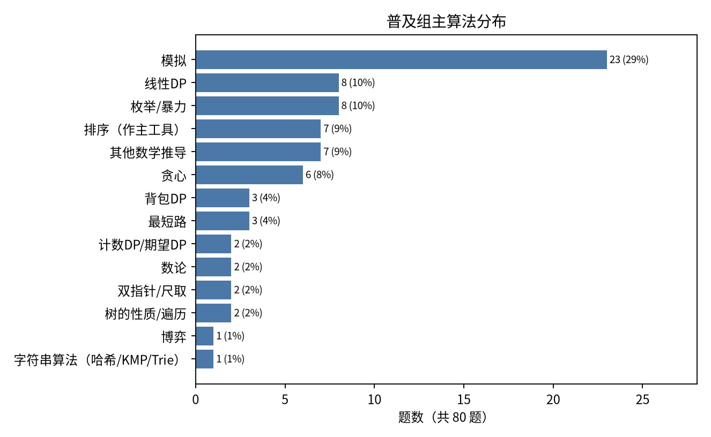
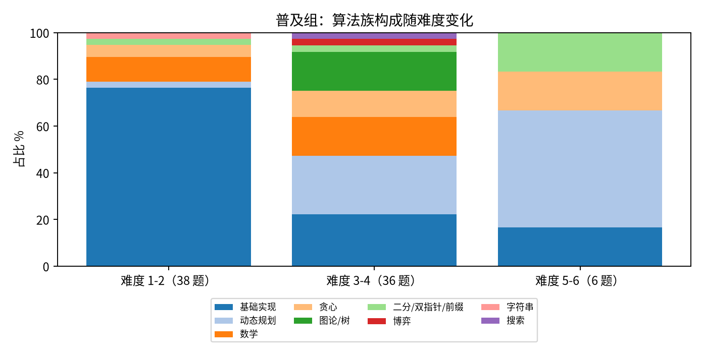
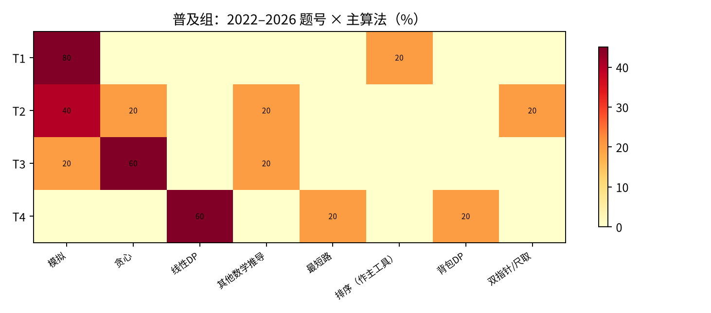
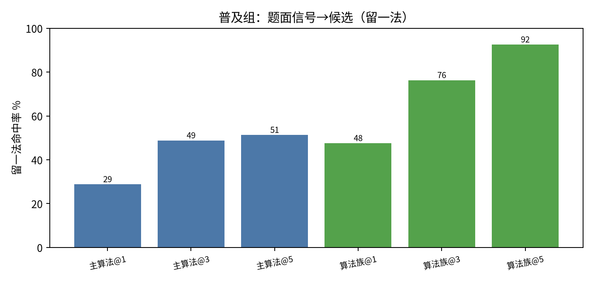

# 普及组算法筛选报告（CSP-J + NOIP 普及组）

> 数据集：2007–2026 年 CSP-J（2019–2026，32 题）+ NOIP 普及组（2007–2018，48 题），共 **80 题**。
> 难度：洛谷新难度 1–5（普及组最高只到难度 5），分布为 1–2 档 38 题（47.5%）、3–4 档 36 题（45.0%）、5–6 档 6 题（7.5%）。
> 统计口径：主算法取「正解主干算法」；组合分析用 2022–2026 的紧口径原子（20 题）与 2007–2021 的「主+次」代理口径分开报告。

## 一、总体画像：基础实现接近一半

| 主算法 | 题数 | 占比 |
|---|---|---|
| 模拟 | 23 | 28.8% |
| 线性 DP | 8 | 10.0% |
| 枚举/暴力 | 8 | 10.0% |
| 排序（作主工具） | 7 | 8.8% |
| 其他数学推导 | 7 | 8.8% |
| 贪心 | 6 | 7.5% |
| 背包 DP | 3 | 3.8% |
| 最短路 | 3 | 3.8% |
| 计数 DP | 2 | 2.5% |
| 数论 / 双指针 / 树性质 | 各 2 | 各 2.5% |

按算法族：**基础实现 47.5%**、动态规划 16.2%、数学 12.5%、贪心 8.8%、图论/树 7.5%、二分/双指针/前缀 3.8%。

几个直接结论：

1. **普及组不是「小提高组」，而是「实现能力测试」**：接近一半的题正解主干是模拟/枚举/排序。
2. **DP 从难度 3 才开始当主角**：难度 1–2 的 38 题里 DP 只有 1 题（背包）；难度 3–4 里线性 DP 已有 5 题；难度 5–6 的 6 题里 3 题是线性 DP。
3. 图论、二分、搜索在普及组都是**点缀**（合计不到 10%），不要为了普及组去堆高级算法。

## 二、难度分层：每一档该练什么

| 难度段 | 题数 | 最高频主算法 |
|---|---|---|
| 1–2 | 38 | 模拟 18、枚举 7、排序 4 |
| 3–4 | 36 | 线性 DP 5、模拟 5、数学推导 4、贪心 4 |
| 5–6 | 6 | 线性 DP 3、其余各 1 |

**备考映射**：

- 目标 T1：模拟/输入输出/字符串处理，不涉及算法。
- 目标 T2：模拟 + 枚举 + 排序 + 简单数学（约 2 档）。
- 目标 T3-T4：前缀和/差分、简单线性 DP、背包、贪心、最短路/BFS、树的遍历。
- 只有冲满分（难度 5）时才需要单调队列、较复杂的 DP 等。

## 三、年代与组别：题目在变，但结构没变

| 算法族 | 2007–2012 | 2013–2018 | 2019–2026 |
|---|---|---|---|
| 基础实现 | 45.8% | 54.2% | 43.8% |
| 动态规划 | 20.8% | 8.3% | 18.8% |
| 数学 | 12.5% | 12.5% | 12.5% |
| 贪心 | 8.3% | 4.2% | 12.5% |
| 图论/树 | 0% | 12.5% | 9.4% |

CSP-J（2019 起）与 NOIP 普及组（2007–2018）对比：CSP-J 的基础实现 14/32（43.8%），普及组 24/48（50.0%）；DP 分别是 6/32 与 7/48；图论各 3 题。**换赛制没有改变「基础实现为主」的结构**，近三年贪心、简单图论略有抬头。

## 四、多算法：普及组基本是单算法

2022–2026 的 20 道 CSP-J 题用紧口径统计：

- 多算法题只有 **2/20（10%）**：P11230 接龙（线性 DP + 单调队列）、P14359 异或和（贪心 + 前缀异或/差分）。
- 其余 18 题都是单算法；难度 1–2 的多算法率为 0%。
- 历史 60 题（2007–2021）里，标了次要算法的只有 16 题（26.7%），且多数是「主算法 + 一个实现技巧」，不是高难题那种强耦合组合。

**筛法含义**：普及组先按单算法出候选；只有 T4 且难度 ≥4 时，再考虑「DP/贪心 + 前缀和/单调队列」这一种组合。

## 五、题号先验：T1–T4 的难度与算法画像

2022–2026 共 20 题（每年 4 题）：

| 位置 | 题数 | 难度分布 | 平均难度 | 主算法 Top3 |
|---|---|---|---|---|
| T1 | 5 | D1×3、D2×2 | 1.40 | 模拟×4、排序×1 |
| T2 | 5 | D2×5 | 2.00 | 模拟×2、数学×1、贪心×1 |
| T3 | 5 | D3×4、D4×1 | 3.20 | 贪心×3、模拟×1、数学×1 |
| T4 | 5 | D3×2、D4×2、D5×1 | 3.80 | 线性 DP×3、最短路×1、背包×1 |

**考场用法**：

- 看到 T1：直接模拟，不要想算法；注意数据类型、边界、字符串细节。
- 看到 T2：枚举/排序/简单贪心/简单数学四选一。
- 看到 T3：大概率是贪心或 DP，先想「能不能排序后贪心」，不行再看 DP/前缀。
- 看到 T4：优先 DP（线性/背包），其次最短路/BFS、树遍历；难度 ≥4 时考虑给 DP 挂单调队列/前缀和优化。

## 六、载体与对象：从题面信号取候选

**载体 → 先想什么**：

| 载体 | 题数 | Top3 主算法 |
|---|---|---|
| 序列/数组 | 24 | 模拟、线性 DP、排序 |
| 整数/数论对象 | 14 | 数学推导、模拟、数论 |
| 字符串 | 12 | 模拟、字符串算法、计数 DP |
| 多重集/物品集合 | 9 | 排序、贪心、枚举 |
| 网格/棋盘 | 7 | 模拟、贪心、最短路 |
| 图 | 4 | 最短路、博弈、搜索 |
| 数值矩阵/坐标/环 | 7 | 数学、枚举、DP |

**对象 → 第一刀**：

| 对象 | 题数 | Top3 主算法 |
|---|---|---|
| 求值（和/期望） | 21 | 模拟、数学推导、排序 |
| 最小 | 18 | 枚举、贪心、线性 DP |
| 计数 | 16 | 模拟、枚举、计数 DP |
| 最大 | 12 | 线性 DP、贪心、博弈 |
| 构造/输出方案 | 8 | 模拟、排序、贪心 |
| 判定 | 5 | 模拟、最短路、线性 DP |

## 七、复杂度画像与预算

普及组正解的复杂度分布：线性 46.2%、O(n log n) 25.0%、平方级 18.8%、常数/对数 7.5%、指数级 2.5%。n 规模以 1e5（22 题）、1e6（11 题）为主，另有 13 题 n≤100。

按 2026 CCF 官方评测机（Ultra 9 285K 锁频、-O2 -std=c++14 -static），1 秒保守预算约 2×10⁸ 次基本操作：

| 规模 | 普及组建议复杂度上限 |
|---|---|
| n ≤ 20 | 暴搜/状压 |
| n ≤ 100 | O(n³)（枚举三维） |
| n ≤ 1e3 | O(n²)（区间 DP/Floyd） |
| n ≤ 1e4 | O(n²) 要小心常数 |
| n ≤ 1e5 | O(n log n) 或 O(n) |
| n ≤ 1e6 | O(n) 或常数很小的 O(n log n) |

## 八、候选锚定能力（留一法）

| 预测目标 | hit@1 | hit@3 | hit@5 |
|---|---|---|---|
| 主算法（19 类） | 28.7% | 48.8% | 51.2% |
| 算法族（9 类） | 47.5% | 76.2% | 92.5% |

读法：在普及组，用「难度段 + 载体 + 对象 + 规模」这四类题面信号，**5 个候选里覆盖正确算法族的概率约 92%**，但具体到 19 个主算法的 5 选 1 只有约一半；主算法直接押中不到三成。所以普及组也要「先出候选集合，再用必要条件排除」，不能看到题就写。

## 九、普及组备考优先级（由数据得出）

1. **模拟 / 输入输出 / 字符串处理**（最高优先级，T1/T2 稳定得分点）。
2. **枚举 + 排序 + 前缀和/差分**（普及组最常用的工具箱）。
3. **简单贪心**（排序后贪心/区间贪心），必须练「证明或举反例」。
4. **线性 DP + 背包**（难度 3–4 的主力；状态设计、边界、滚动数组）。
5. **BFS/最短路、树遍历**（难度 3–4 的图论题只有最短路和遍历级别）。
6. 最后才是单调队列/区间 DP 等难度 5 的内容。

## 十、局限

- 80 题里难度 5–6 只有 6 题，高分段统计不稳定；2022–2026 只有 20 题，题号先验的样本很小。
- 主算法是「主流正解」的归纳，一题多解时只取一种；2007–2021 的组合分析是「主+次」代理口径，不与紧口径原子直接比较。
- 难度是主观评定且会调整；复杂度预算以 2026 年官方题面为准，之后可能变化。
