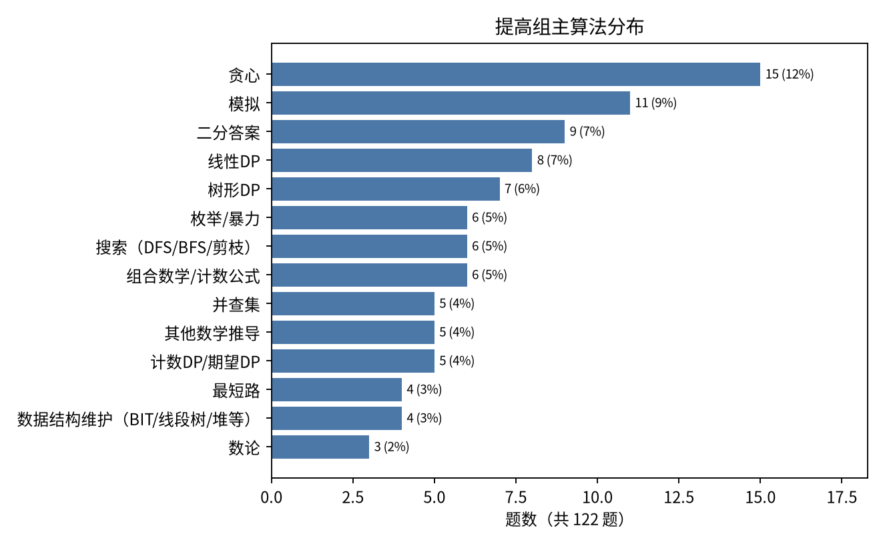
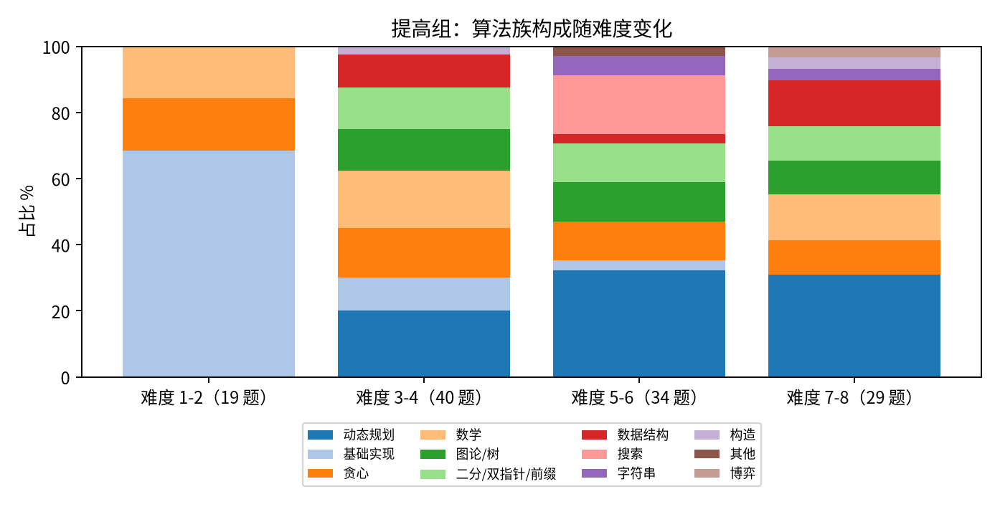
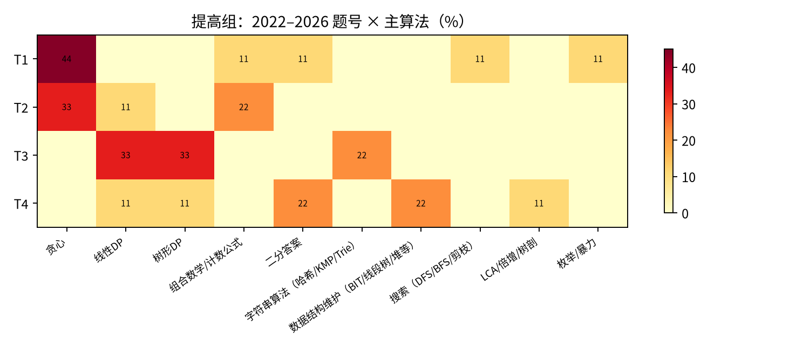
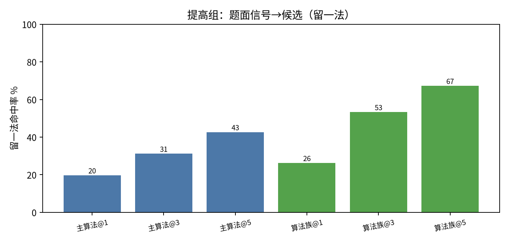

# 提高组算法筛选报告（CSP-S + NOIP 提高组 / NOIP）

> 数据集：2007–2026 年 CSP-S（2019–2026，34 题）+ NOIP 提高组（2007–2018，64 题；2020–2025，24 题），共 **122 题**。
> 难度：洛谷新难度 2–8，分布为 1–2 档 19 题、3–4 档 40 题、5–6 档 34 题、7–8 档 29 题。
> 口径：主算法取正解主干；2022–2026 的组合分析用紧口径原子（36 题），2007–2021 用「主+次」代理口径（71 题），两者不直接混合比较。

## 一、总体画像：DP 是最大体系，但「基础实现」仍占近 15%

| 主算法 | 题数 | 占比 |
|---|---|---|
| 贪心 | 15 | 12.3% |
| 模拟 | 11 | 9.0% |
| 二分答案 | 9 | 7.4% |
| 线性 DP | 8 | 6.6% |
| 树形 DP | 7 | 5.7% |
| 枚举/暴力 | 6 | 4.9% |
| 搜索 | 6 | 4.9% |
| 组合数学/计数公式 | 6 | 4.9% |
| 并查集 | 5 | 4.1% |
| 其他数学推导 | 5 | 4.1% |
| 计数 DP | 5 | 4.1% |
| 最短路 | 4 | 3.3% |
| 数据结构维护 | 4 | 3.3% |
| LCA/倍增 / 数论 / 字符串 | 各 3 | 2.5% |

按算法族：**动态规划 23.0%**、基础实现 14.8%、贪心 13.1%、数学 11.5%、图论/树 9.8%、二分/双指针/前缀 9.8%、数据结构 7.4%、搜索 4.9%、字符串 2.5%。

关键判断：

1. **提高组的主线是 DP + 贪心 + 二分**，三者合计约 33%；加上基础实现和数学接近 60%。
2. **「数据结构维护」作为主算法的比例只有 7.4%**，但它几乎总是以「第二原子」出现（见第五节），所以不能因为占比低就不练。
3. 搜索只剩 4.9%，且 6 道全部落在难度 5–6：纯搜索题基本退出提高组中低段。
4. 字符串从 2019 年后开始出现（3 题全在近 8 年），是一个小但新增的方向。

## 二、难度分层：每一档的算法画像

| 难度段 | 题数 | Top 主算法 |
|---|---|---|
| 1–2 | 19 | 模拟 8、枚举 4、贪心 3 |
| 3–4 | 40 | 贪心 5、并查集 4、组合数学 4、二分答案 4 |
| 5–6 | 34 | 搜索 6、贪心 4、二分答案 3、计数 DP 3 |
| 7–8 | 29 | 树形 DP 5、数据结构 3、线性 DP 2、贪心 3 |

**备考映射**：

- 难度 2–3（T1/T2 前半）：模拟、枚举、贪心、简单数学——先把「稳」拿下。
- 难度 4–5（T2/T3）：二分答案、并查集、简单图论、线性 DP、组合计数。
- 难度 6（T3）：DP（计数/线性/树形）+ 二分 + 搜索。
- 难度 7–8（T4）：树形 DP、数据结构优化、复杂构造/数学；几乎全部是多算法题。

## 三、年代趋势与组别差异

| 算法族 | 2007–2012 | 2013–2018 | 2019–2026 |
|---|---|---|---|
| 动态规划 | 10.7% | 25.0% | 27.6% |
| 基础实现 | 28.6% | 16.7% | 6.9% |
| 贪心 | 7.1% | 8.3% | 19.0% |
| 数学 | 10.7% | 11.1% | 12.1% |
| 图论/树 | 10.7% | 11.1% | 8.6% |
| 二分/双指针/前缀 | 14.3% | 11.1% | 6.9% |
| 数据结构 | 3.6% | 11.1% | 6.9% |
| 搜索 | 10.7% | 5.6% | 1.7% |
| 字符串 | 0% | 0% | 5.2% |

**近 8 年最明显的变化**：基础实现从 28.6% 跌到 6.9%，DP 升到 27.6%，贪心升到 19.0%，纯搜索几乎消失。提高组已经不是「模拟大赛」，而是 **DP + 贪心证明 + 组合设计**。

CSP-S 与 NOIP 提高组的差异（注意两者题量与年份不同，只作方向参考）：

| 项目 | CSP-S（34 题） | NOIP 提高（88 题） |
|---|---|---|
| 平均难度 | 5.26 | 4.49 |
| DP | 10 | 18 |
| 基础实现 | 3 | 15 |
| 贪心 | 8 | 8 |
| 数学 | 2 | 12 |
| 图论/树 | 4 | 8 |
| 二分/双指针/前缀 | 2 | 10 |
| 数据结构 | 0（主算法） | 9 |

CSP-S 更偏「DP/贪心/构造」，NOIP 提高组的历史题里数学、二分、数据结构更多。

## 四、多算法：提高组的主旋律

2022–2026 的 36 道提高组题（CSP-S 20 + NOIP 提高 16）用紧口径统计：

- **多算法题 23/36（63.9%）**；
- 按难度：1–2 档 0%、3–4 档 50%、5–6 档 70%、**7–8 档 85.7%**；
- 组合类型：single 13、pipeline 9、optimize 8、check 3、hybrid 3。

**结论**：从难度 5 开始，默认按「两个算法阶段」准备；难度 7–8 基本不存在单算法题。

高频「离子」（多原子组合，≥2 题）：

| 组合 | 题数 | 场景 |
|---|---|---|
| 数据结构维护 + LCA/倍增 | 2 | 树上路径查询/合并 |
| 数据结构维护 + 单调栈/队列 | 2 | 单调结构 + 区间维护 |
| 线性 DP + 数据结构维护 | 2 | DP 转移加速 |
| 树形 DP + 数据结构维护 | 2 | 子树合并/路径统计 |

四种重复出现的组合**全部以数据结构为枢纽**；其余多原子组合各 1 题（长尾）。**没有可以背的「万能组合」**，能稳定说的是：高难题先问「要不要在 DP/贪心上挂数据结构」。

## 五、题号先验（2022–2026）

| 位置 | 题数 | 难度分布 | 平均难度 | 主算法 Top3 | 多算法率 |
|---|---|---|---|---|---|
| T1 | 9 | D2×4、D3×2、D4×1、D5×2 | 3.11 | 贪心×4、搜索、组合数学 | 33.3% |
| T2 | 9 | D4×5、D5×2、D7×2 | 4.89 | 贪心×3、组合数学×2、线性 DP | 44.4% |
| T3 | 9 | D5×1、D6×3、D7×4、D8×1 | 6.56 | 树形 DP×3、线性 DP×3、字符串×2 | 77.8% |
| T4 | 9 | D6×2、D7×4、D8×3 | 7.11 | 数据结构×2、二分答案×2、LCA×1 | 100% |

**考场用法**：

- T1：贪心/模拟/简单数学，目标是「快且稳」，不要在这里秀算法。
- T2：贪心、组合数学、线性 DP；开始出现 7 档题。
- T3：树形 DP/线性 DP/字符串/DP 优化；默认准备两个原子。
- T4：数据结构、二分答案、LCA/树剖；默认多算法，先想「DP/贪心 + 结构」。

## 六、载体与对象

| 载体 | 题数 | Top3 主算法 |
|---|---|---|
| 序列/数组 | 28 | 贪心、线性 DP、模拟 |
| 树/森林 | 17 | 树形 DP、二分答案、树性质 |
| 图 | 15 | 最短路、并查集、最小生成树 |
| 字符串 | 13 | 模拟、字符串算法、贪心 |
| 整数/数论对象 | 10 | 枚举、数论、组合数学 |
| 网格/棋盘 | 9 | 搜索、组合数学、线性 DP |
| 多重集/物品集合 | 9 | 贪心、搜索、单调队列 |

| 对象 | 题数 | Top3 主算法 |
|---|---|---|
| 最小 | 32 | 贪心、二分答案、搜索 |
| 计数 | 26 | 组合数学、计数 DP、枚举 |
| 最大 | 23 | 线性 DP、二分答案、贪心 |
| 求值（和/期望） | 23 | 模拟、树形 DP、枚举 |
| 构造/输出方案 | 10 | 贪心、模拟、构造 |
| 判定 | 7 | 模拟、并查集、字符串 |

**载体→候选**：序列先想贪心/DP；树先想树形 DP/二分/LCA；图先想最短路/并查集/MST；字符串先想模拟/哈希/KMP。

## 七、复杂度画像与预算

提高组正解复杂度：线性 41.0%、O(n log n) 33.6%、平方级 20.5%、指数 2.5%、立方 1.6%、常数/对数 0.8%。n 规模：1e5（48 题）、1e3（19）、1e6（18）、100（12）、1e4（8）、1e7（6）、20（4）。

按 2026 CCF 官方评测机（Ultra 9 285K 锁频、-O2 -std=c++14 -static），1 秒保守预算约 2×10⁸ 次基本操作：

| 规模 | 建议复杂度上限 | 提高组常见做法 |
|---|---|---|
| n ≤ 20 | 状压/暴搜 | 状压 DP、枚举子集 |
| n ≤ 100 | O(n³) | Floyd、区间 DP、三维枚举 |
| n ≤ 1e3 | O(n²) | 区间 DP、二维 DP、邻接矩阵 |
| n ≤ 1e4 | O(n²) 要小心 | DP 预处理、离线 |
| n ≤ 1e5 | O(n log n) | 树/图/二分/树状数组 |
| n ≤ 1e6 | O(n)/小常数 O(n log n) | 贪心、模拟、一次扫描 |
| 随机访存 | 2×10⁷/s 量级 | 指针/哈希表/树结构要降规模 |

**提高组特别注意**：随机访存（树链剖分、平衡树、哈希表、虚树）的实际常数远高于顺序访问；「复杂度对但常数炸」在提高组比普及组常见得多。

## 八、候选锚定能力（留一法）

| 预测目标 | hit@1 | hit@3 | hit@5 |
|---|---|---|---|
| 主算法（30 类） | 19.7% | 31.1% | 42.6% |
| 算法族（12 类） | 26.2% | 53.3% | 67.2% |

读法：仅靠「难度段 + 载体 + 对象 + 规模」，3 个候选只能覆盖约 53% 的算法族、5 个约 67%；主算法 5 选 1 命中约 43%。提高组的题面信号比普及组弱得多，**必须靠必要条件检验和结构分析收敛**，不能靠「看关键词猜算法」。

## 九、提高组备考优先级（由数据得出）

1. **DP 全家桶**（23%）：线性、树形、背包、计数、区间、DAG 上 DP；先练状态设计与转移，再练优化。
2. **贪心**（13.1%）：排序贪心、区间贪心、反悔贪心（堆）；必须练证明与反例。
3. **基础实现**（14.8%）：主要出现在 T1/T2 与低难度；别在考场上把简单题做复杂。
4. **二分答案**（7.4%，二分族合计 9.8%）：判定单调性 + check 设计，是提高组最划算的「套路」之一。
5. **数学**（11.5%）：组合计数、数论、递推/矩阵；常在 T2/T3。
6. **图论/树**（9.8%）：最短路、并查集、MST、树形 DP、LCA；注意建模与「图的性质」。
7. **数据结构**（主算法 7.4%，但作为第二原子高频）：线段树/树状数组/堆/单调队列/并查集，重点练「DP/贪心 + 结构」的组合。
8. **搜索**（4.9%）：难度 5–6 的暴力/剪枝/迭代加深；不要一开始就想搜索。

## 十、提高组筛法总结

1. 看题号定难度（T1≈3、T2≈5、T3≈6.5、T4≈7）；看难度定候选族。
2. 看输出/载体/对象取 2–4 个候选算法（见第六节）。
3. 若难度 ≥5：强制问一句「第二个算法阶段是什么」——统计上 70%+ 有第二个原子。
4. 若候选是 DP/贪心且 n 大：优先考虑「+数据结构优化」（线段树/树状数组/堆/单调队列）。
5. 若候选是树/图：先检查是否能用 LCA/树剖/并查集/MST 降复杂度。
6. 用必要条件表排除，再写暴力对拍；提高组约 93.4% 的题面有分档，先拿部分分。

## 十一、局限

- 122 题里 2007–2021 的组合分析是「主+次」代理口径，与 2022–2026 的紧口径原子不可直接比较；难度 7–8 的 29 题中 15 题是本次补标、多为 medium/low confidence。
- 位置先验只有 2022–2026 的 36 题（每年组别 4 题），样本小；历史 NOIP 有 6 题/两天的情况，题号语义与现在不同。
- 主算法是「主流正解」的归纳，一题多解只取一种；难度为主观评定且会调整。
- 复杂度预算以 2026 年官方评测机为准，之后可能变化。
